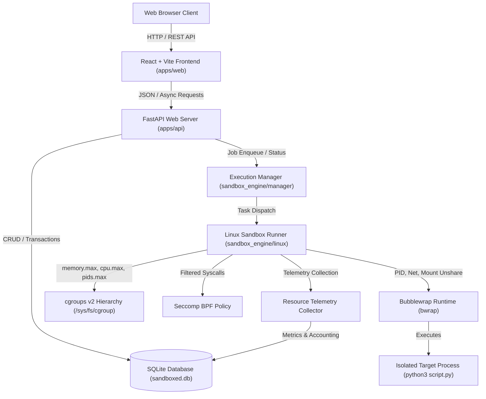
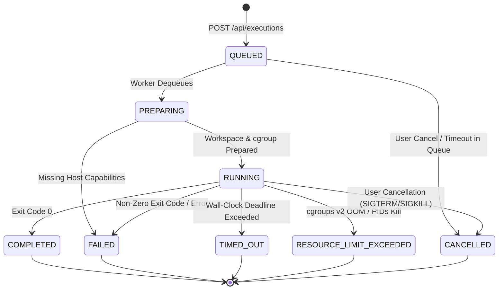

# Sandboxed System Architecture

"Sandboxed: Design and Implementation of a Linux-Based Isolated Program Execution and Resource Monitoring System"

## 1. Architectural Overview

Sandboxed is structured as a decoupled multi-layer systems architecture designed to enforce hardware resource boundaries, namespace isolation, and system call filtering on untrusted code execution.

---

## 2. Component Responsibilities

### A. React Frontend (`apps/web`)
- **Technology Stack**: React 18, Vite, Tailwind CSS, React Router, Lucide Icons, Recharts, CodeMirror.
- **Role**:
  - Provides an interactive developer-tool interface.
  - **Overview**: Real-time metrics, system health, host isolation readiness.
  - **Playground**: Python code editor, workload presets, execution submission, live output streaming (stdout/stderr), execution telemetry.
  - **Executions**: Searchable execution history, exit code inspector, memory/CPU metrics viewer.
  - **Policy Lab**: Comparative multi-policy execution benchmark with comparative bar charts and OS result interpretation.
  - **Security Policies**: Configuration and inspection of fine-grained resource and syscall limits.
  - **System Information**: Live diagnostics of host kernel, cgroups v2, namespaces, and bubblewrap.
  - **Settings**: Concurrency, queue capacity, and storage parameters.

### B. FastAPI Backend API (`apps/api`)
- **Technology Stack**: Python 3.10+, FastAPI, Pydantic v2, Uvicorn, SQLAlchemy.
- **Role**:
  - Validates request payloads and enforces server-side policy invariants.
  - Manages SQLite relational persistence for executions, policies, experiments, and audit logs.
  - Coordinates execution queue dispatch without ever executing submitted code inside the API process.
  - Exposes OpenAPI documentation at `/docs`.

### C. Execution Manager (`sandbox_engine/manager`)
- **Role**:
  - Manages asynchronous FIFO job queue with configurable concurrency (default 1 worker).
  - Maintains the execution lifecycle state machine:
    $$\text{QUEUED} \longrightarrow \text{PREPARING} \longrightarrow \text{RUNNING} \longrightarrow \{\text{COMPLETED}, \text{FAILED}, \text{TIMED\_OUT}, \text{CANCELLED}, \text{RESOURCE\_LIMIT\_EXCEEDED}\}$$
  - Coordinates cancellation and signal escalation (SIGTERM $\rightarrow$ SIGKILL).
  - Emits lifecycle audit events.

### D. Linux Sandbox Runner (`sandbox_engine/linux`)
- **Role**:
  - **Capability Probing (`capabilities.py`)**: Gathers kernel release, cgroups v2 status, controllers (`cpu`, `memory`, `pids`), user delegation permissions, and bubblewrap availability. Refuses to run if prerequisites are unmet.
  - **Bubblewrap Builder (`bwrap_builder.py`)**: Constructs least-privilege bubblewrap CLI arguments (`--unshare-all`, `--unshare-net`, `--ro-bind` runtime libraries, `--tmpfs /tmp`, `--bind /workspace`).
  - **cgroups v2 Manager (`cgroup_v2.py`)**: Allocates execution child slices under `sandboxed.slice`, writes `memory.max`, `cpu.max`, `pids.max`, attaches PID, and unlinks cgroups after termination.
  - **Syscall Filter (`seccomp_filter.py`)**: Defines standard and strict BPF denylists blocking kernel modification, raw sockets, and process tracing.
  - **Process Supervisor (`supervisor.py`)**: Sets new process group (`setsid`), reads bounded output non-blockingly without pipe deadlock, and enforces high-resolution wall-clock deadlines.

### E. Telemetry & Accounting (`sandbox_engine/monitoring`)
- **Role**:
  - Parses physical resource usage from cgroups v2 controller files:
    - `cpu.stat`: Total, user, and kernel CPU time.
    - `memory.peak`: Kernel-recorded peak physical memory allocation.
    - `memory.events`: Out-Of-Memory (OOM) killer events.
    - `pids.events`: Max process events.
  - Clearly distinguishes user-requested policy limits from measured physical consumption.

---

## 3. Execution Lifecycle State Machine

